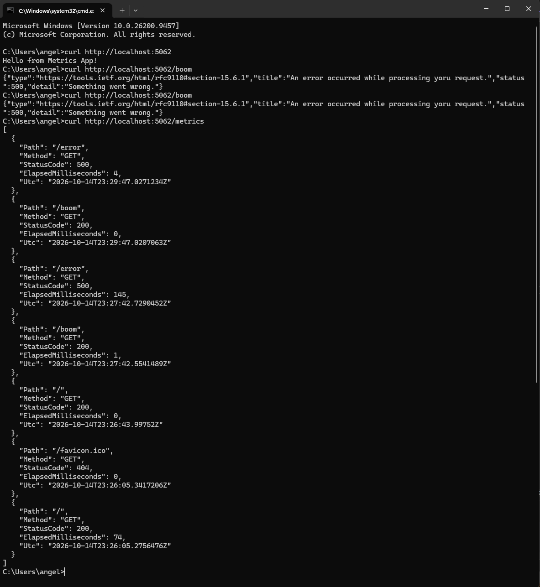

# MetricsApp

ASP.NET Core minimal API that demonstrates custom middleware, request timing, and global exception handling.

## Features
- **RequestTimingMiddleware** – times every request with a Stopwatch, logs it to the console, and keeps the last 20 requests in a static queue.
- **GET /metrics** – returns the last 20 requests (path, method, status code, duration) as JSON.
- **Global exception handler** – `UseExceptionHandler("/error")` catches unhandled exceptions.
- **GET /error** – returns a Problem Details (500) response.
- **GET /boom** – throws an exception to test the error handler.

## How to Run
dotnet run

Then visit `/`, `/boom`, and `/metrics`.

## Sample /metrics Output
```
[
  {
    "Path": "/error",
    "Method": "GET",
    "StatusCode": 500,
    "ElapsedMilliseconds": 4,
    "Utc": "2026-10-14T23:29:47.0271234Z"
  },
  {
    "Path": "/boom",
    "Method": "GET",
    "StatusCode": 200,
    "ElapsedMilliseconds": 0,
    "Utc": "2026-10-14T23:29:47.0207063Z"
  },
  {
    "Path": "/error",
    "Method": "GET",
    "StatusCode": 500,
    "ElapsedMilliseconds": 145,
    "Utc": "2026-10-14T23:27:42.7290452Z"
  },
  {
    "Path": "/boom",
    "Method": "GET",
    "StatusCode": 200,
    "ElapsedMilliseconds": 1,
    "Utc": "2026-10-14T23:27:42.5541489Z"
  },
  {
    "Path": "/",
    "Method": "GET",
    "StatusCode": 200,
    "ElapsedMilliseconds": 0,
    "Utc": "2026-10-14T23:26:43.99752Z"
  },
  {
    "Path": "/favicon.ico",
    "Method": "GET",
    "StatusCode": 404,
    "ElapsedMilliseconds": 0,
    "Utc": "2026-10-14T23:26:05.3417206Z"
  },
  {
    "Path": "/",
    "Method": "GET",
    "StatusCode": 200,
    "ElapsedMilliseconds": 74,
    "Utc": "2026-10-14T23:26:05.2756476Z"
  }
]
```

## Error Page Screenshot
